# Redesign, October 2026

## Direction 2: dark, image first, one voice

The first direction (three switchable skins: Deco, Blueprint, Aquarelle)
was built, reviewed and rejected on 10 October: the skins said more about
the medium than about the work. Konstancja pointed at three references
instead: [marcuslorenzet.com](https://www.marcuslorenzet.com/),
[nk.studio](https://www.nk.studio/es) with its
[Pomelo case](https://www.nk.studio/es/proyectos/pomelo), and
[gladeye.com/work](https://www.gladeye.com/work) with
[The Examination](https://www.gladeye.com/work/the-examination).

What they have in common, and what this direction takes from them:

- A dark ground and one display face set very large and sure of itself.
  Here: ground `#0f0f0e`, ink `#f1ede4`, one sand accent `#e3d2ad`;
  Bricolage Grotesque for display, Inter for body (the CV uses Inter too,
  so the two read as one person).
- The author's portrait in the hero, desaturated, with the claim set over
  it.
- Work as large image tiles in two columns; the covers carry the colour.
- A strip of numbers; a short "how I work"; a large closing line with the
  e-mail.
- Case studies led by images, with short text sections, metadata, pull
  quotes and results at the end. The template now: the title very large
  on the ground, the cover art as one wide image that drifts slower than
  the page, the lead in display type, chapter heads as label on the left
  and maxim on the right (after marcuslorenzet.com/glide), images and
  chapters that reveal on first sight, numbers that count up, clips that
  play while in view (`clip: true` on a video block), a next-project tile
  with its cover.
- The work grid breaks its rhythm: a wide tile and a narrow one that sits
  lower, sides swapped every row, a "View" pill that follows the cursor.

What was kept from the first pass: the sitemap and robots, the 2026
award, the Umami events, the writing rules in `docs/STYLE.md`, the CV.

## The journey through scales

After michalnawrot.github.io, which travels through powers of ten as the
reader scrolls, the home page travels through the scales of the work: the
screen (the hero: the viewport drawn as an app shell), a component (the
work: one card with its slots and dimensions), a token (how I work: the
spacing scale and the colour ramp), a pixel (off screen: a magnified grid
with a few sand pixels lit), and back out to the screen at the contact
line. One canvas behind the page draws the scenes from lines in the two
inks; between stops the outgoing scene zooms past and the next resolves
out of it; dust streaks while the page moves. A ruler on the left edge and
a readout in the corner say where the reader is, in pixels. Under
prefers-reduced-motion each stop is a still.

| | |
| --- | --- |
| 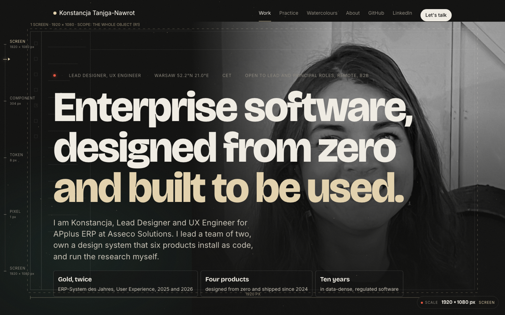 | 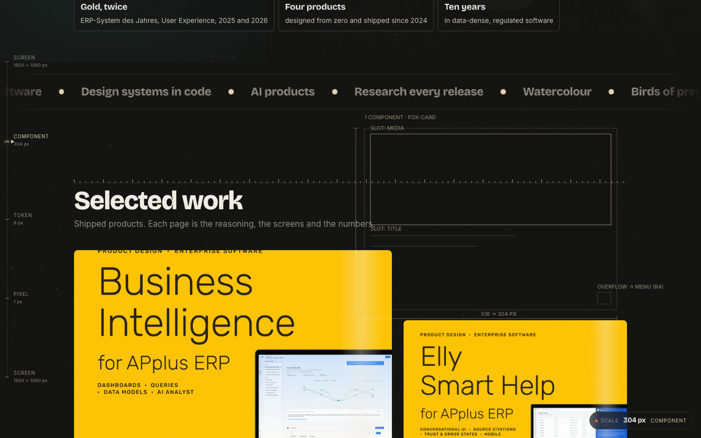 |
| 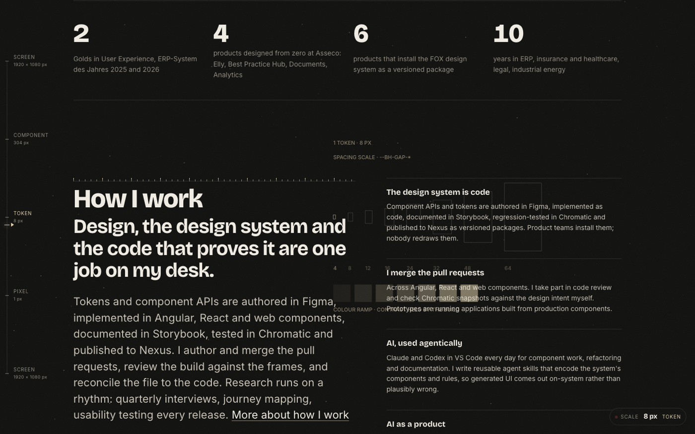 | 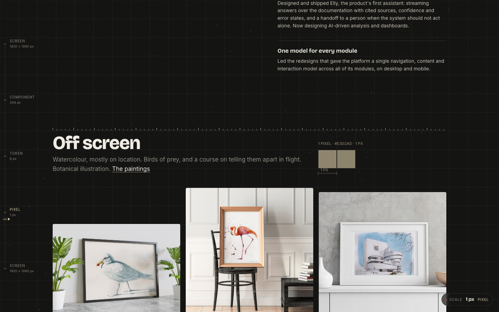 |

## 11 October: the walls

- Every desktop screen on every case study sits in a MacBook: the
  Analytics screens from Konstancja's own device frames in Figma, the
  other seven case studies composited into one bezel template (lid, base,
  shadow) from their flat exports. Diagrams, phones and photographs stay
  as they are.
- The Analytics intro is four screens of the product blending into one
  another in depth, with a chart that draws itself in sand; the same stack,
  with five products, is the home page cover. "What it is" is a carousel
  through every part of the application. Diagrams and code are drawers
  that open on request; long tables fold to their keys; use cases show the
  actor, trigger, rule and exits and keep the step-by-step behind "Show
  more"; the closing questions are joined to their answers by a drawn
  connector, after the data-model canvas.
- Depth on every page: a dust canvas and two slow washes of light, a
  faint drawing-sheet grid behind the walls, dust that streaks with the
  scroll. Motion is varied by what an image is: a scan crosses a mockup
  once as it arrives and then it breathes; a diagram develops from blur;
  a pair slides in from both sides; a set arrives cell by cell.

| | |
| --- | --- |
| 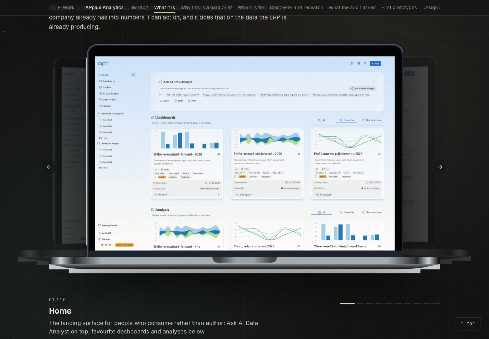 | 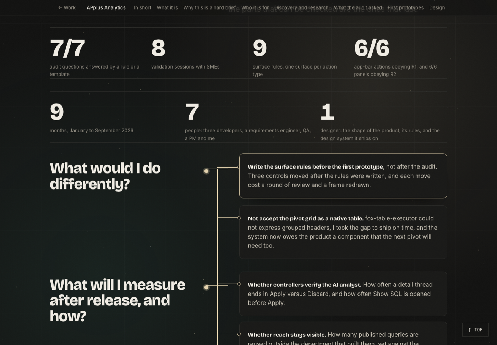 |

## 14 October: depth

A walk-through of the live site, then a page of ideas with live sketches:
[depth-ideas/index.html](depth-ideas/index.html) (also published as a
claude.ai artifact). Konstancja chose:

- **The screen comes apart.** Between the hero and the work the page pins
  the APplus Analytics dashboard and, as the reader scrolls, tilts it into
  an axonometric view and lifts it into the scales the journey names:
  layout, FOX components, tokens, one pixel, with a plumb line from the
  pixel down to the screen. CSS 3D only (`system/Exploded.tsx`, data in
  `home/exploded.ts`), so the screen stays as sharp as the image. The
  components are crops of one export until her Figma layers arrive (DMS,
  BI, Elly, Best Practice Hub); a part with its own `src` replaces its crop.
- **The journey stays and grows.** Its overlays are part of the look; the
  exploded screen sits inside the screen-to-component stretch of it.
- **A larger hero image**, the screens carousel kept.
- **The cover carried into the case.** View transitions: the tile's cover,
  with its app image, grows into the case hero while the home falls back.
  Every cover keeps a representative screen, for recruiters.
- **Off screen on flat scans** (Chenonceau, Chambord, Le Cèdre Noir)
  instead of room mockups.

Not taken: the pixel blooming into a watercolour. Undecided: the contact
screen built back up.

| | |
| --- | --- |
| 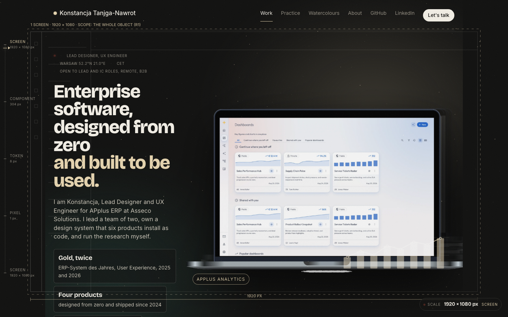 | 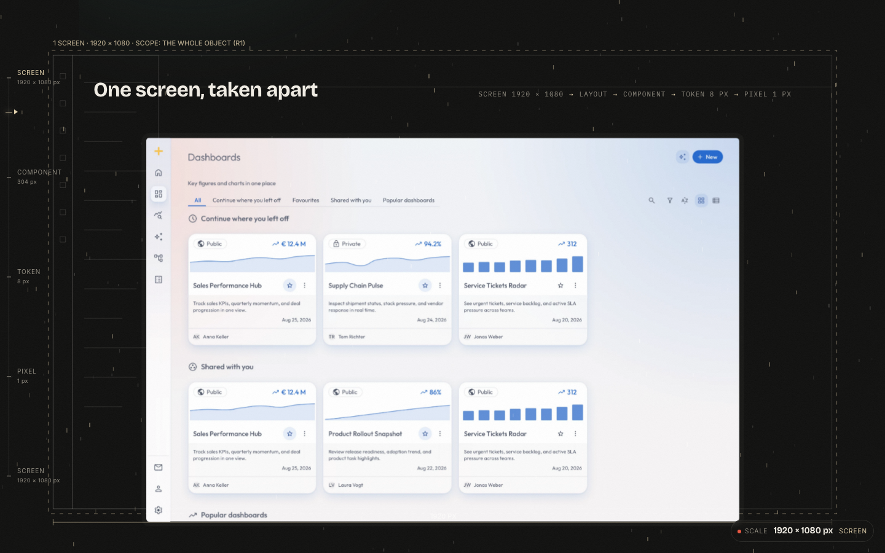 |
| 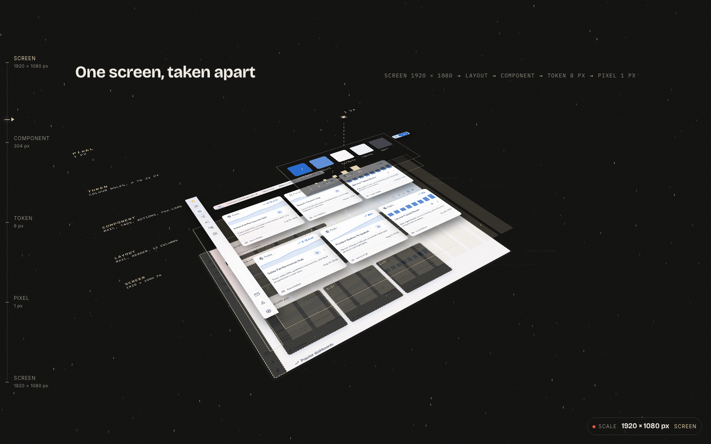 | 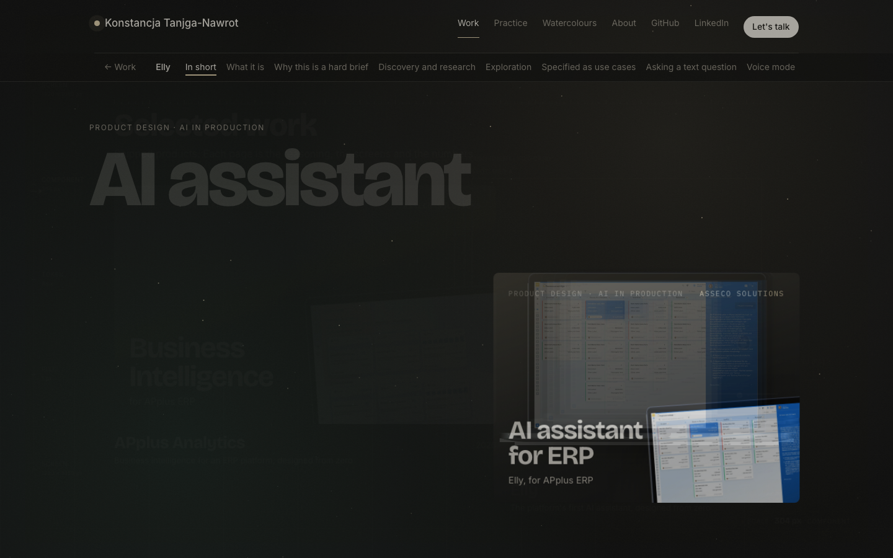 |

Off screen on scans: [off-screen-scans.png](off-screen-scans.png).

### Documents and Best Practice Hub, taken apart

The same 3D view as the home page, now a case-study block (`kind: "exploded"`),
in each study's "Design system" chapter. Built from Konstancja's Figma frames
(Documents node 634:19568, Hub node 632:31992), exported at 2x; every part
sits at its layer's position from the Figma file, named after the layer or,
for the Hub, after the components its study names. Data in
`site/src/content/exploded.ts`.

| | |
| --- | --- |
| 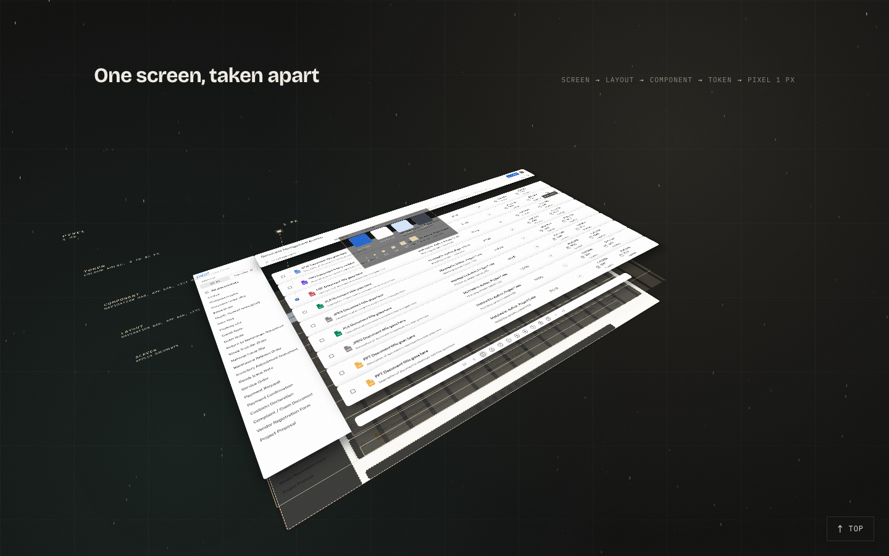 | 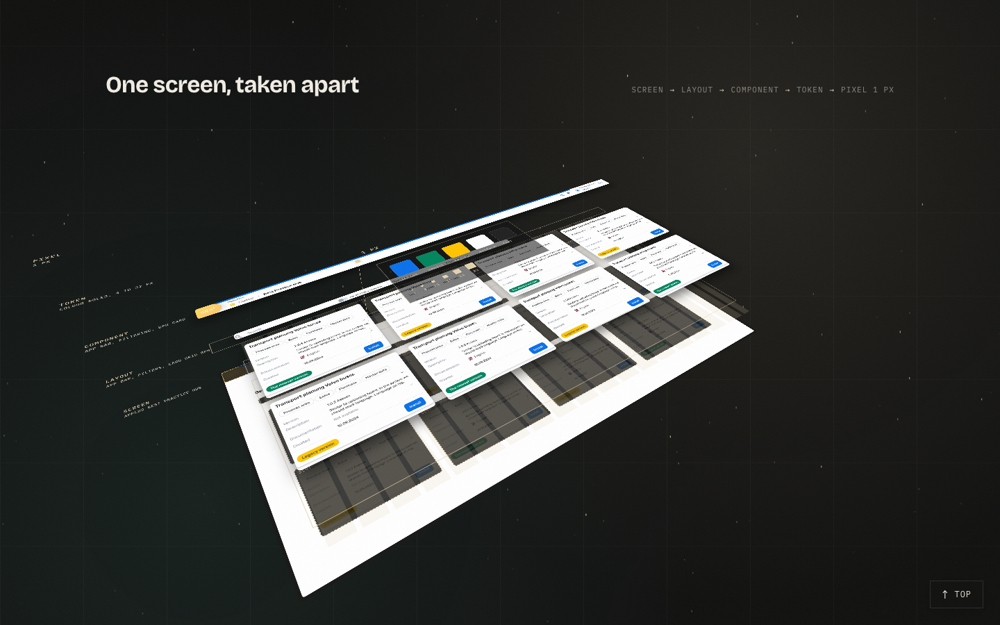 |

## Screens

| | |
| --- | --- |
| 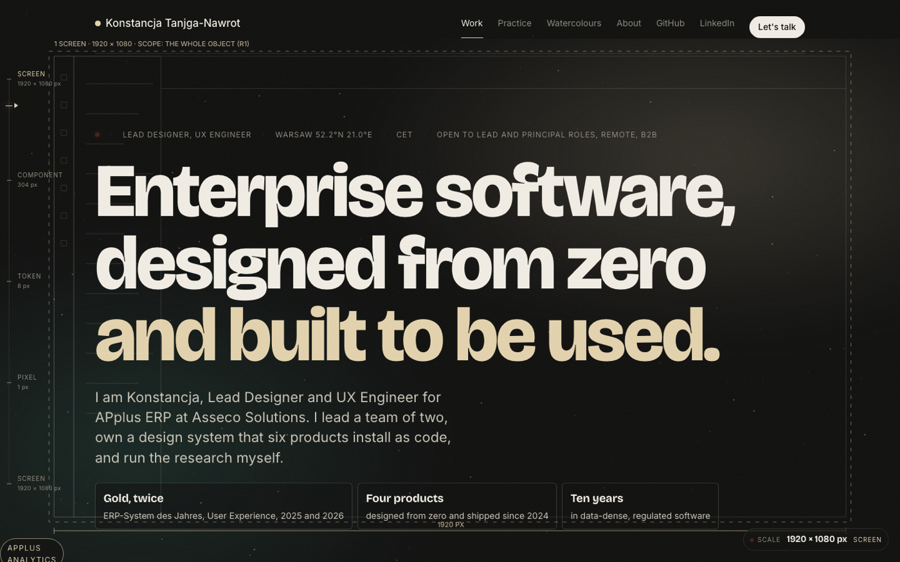 | 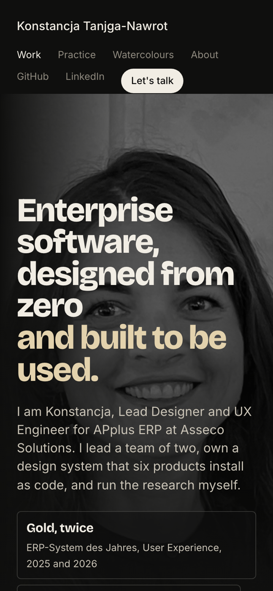 |
|  | 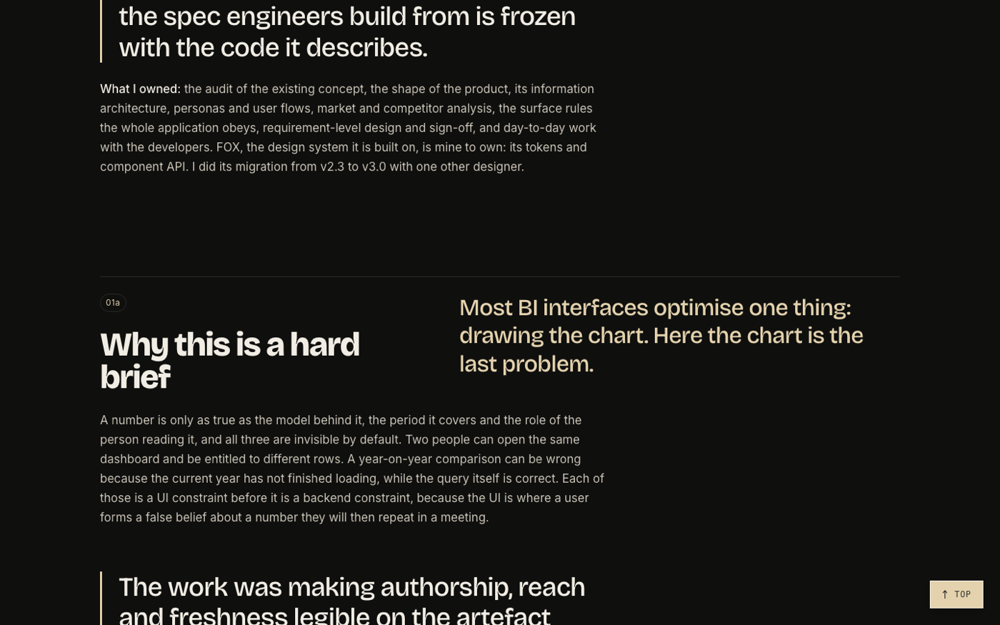 |

Full page: [home-full.png](home-full.png). A case cover on the sand
field: [case-cover.png](case-cover.png).

## Open

- A better portrait: posed, higher resolution, plain background. The
  current one is a casual photo and sits behind the headline only just.
- The case study template in this direction (hero, metadata, galleries,
  pull quotes, results).

### Volvo Group ERP: Partner, User, and Unit screens, user flows, 3D

The study rebuilt in the APplus Analytics layout from three of Konstancja's Figma files ("Partner", "USER", and "UNIT"): thirteen screens in the carousel, Partner Details taken apart in the "Design system" chapter, and a "User flows" dossier with Partner, User, and Unit, each a flow of steps and a folder per screen. Personal data on every new mockup is blurred. Edit log: `docs/copy-edit/log-volvo.md`.

| | |
| --- | --- |
| 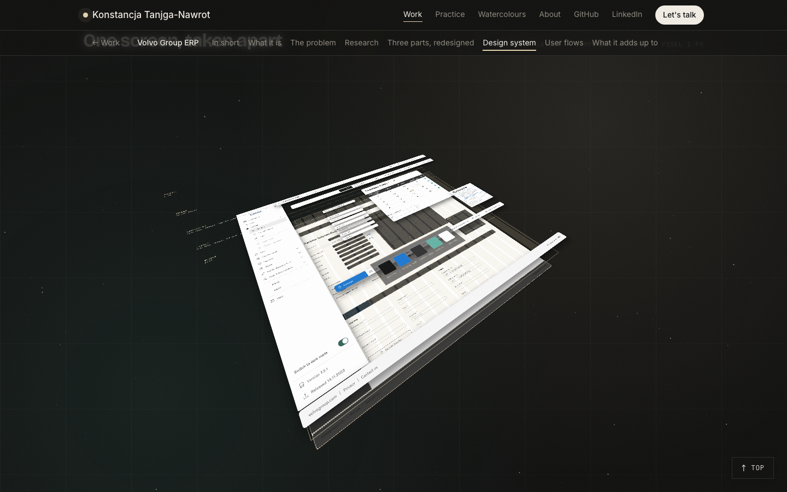 | 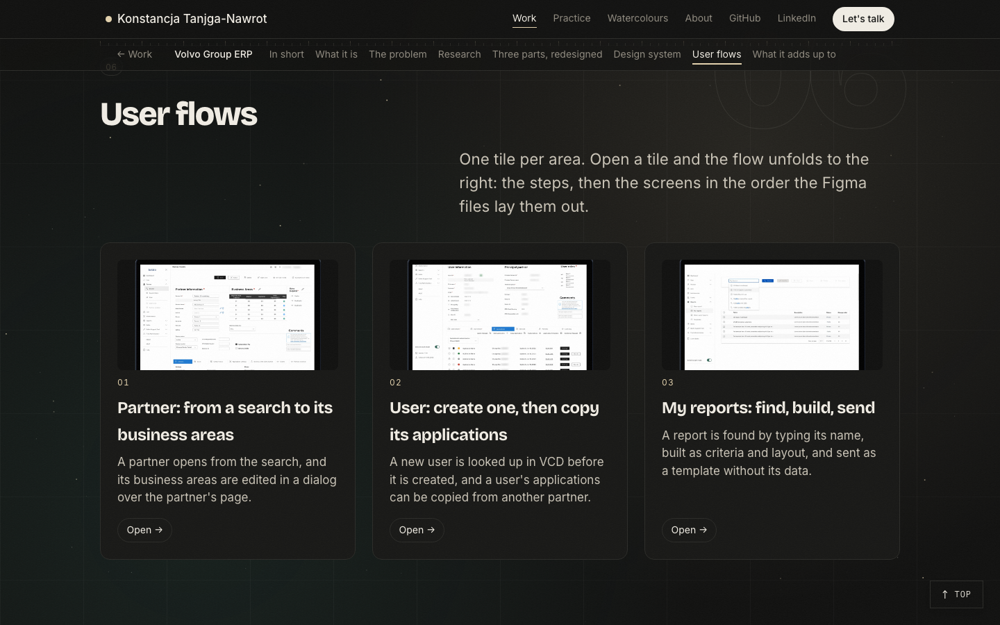 |
| 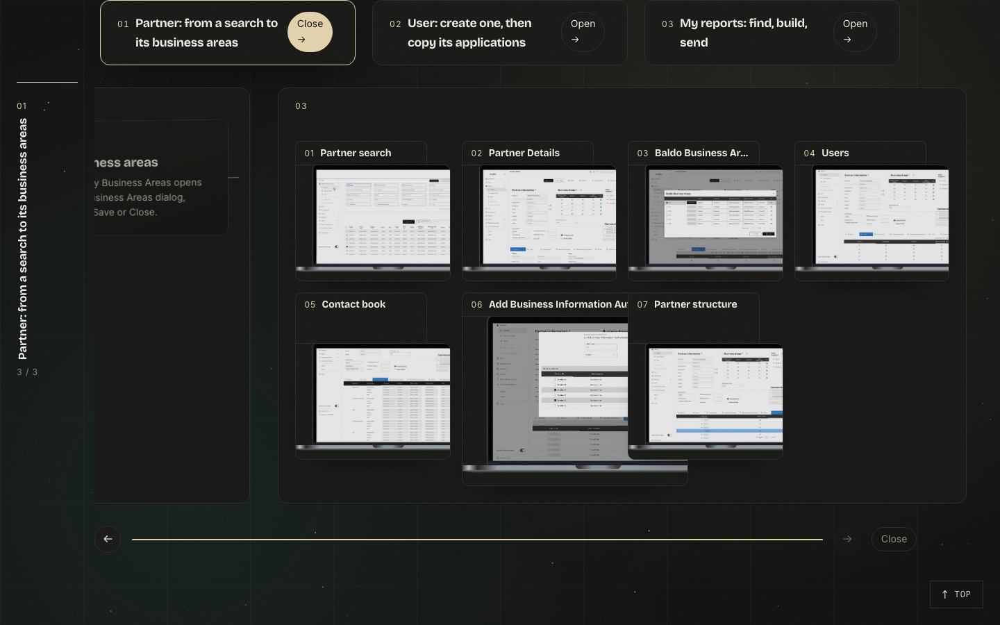 | |

## 15 October: how I work, drawn

Konstancja's brief: the "How I work" section spoke in text, and she
speaks in pictures; show how she works and which tools she uses, and
iterate until it is something to be proud of. Then, mid-build: the tools
have to be visible.

The section is now a drawing sheet (`site/src/home/Sheet.tsx`, words in
`home/story.tsx`). One real component, the chart card from the Analytics
dashboard, cropped from the same export and rects the exploded screen
uses, goes through the eight tools it passes between the first option and
the shipped screen. Each station is that tool's window, drawn in the two
inks with the card inside it as the tool would show it: three options
with one chosen (Claude Design), under selection handles (Figma), as a
specification beside a Figma MCP prompt (Claude Code), as a story with
its states (Storybook), as a baseline and a hatched diff (Chromatic), as
a merged pull request (GitHub), as a package with a barcode (Nexus), and
back in place, outlined, on the dashboard it came from. A conveyor line runs through the station numbers, as text sits on a
dimension line, and is drawn by the scroll with the card as a square at
its head; a station lights when the head reaches it. The line is routed
after layout, so the same drawing wraps at four columns, two, or one.

Along the top, the tools with their marks (Simple Icons, CC0, one path
each in `home/marks.tsx`): Figma, Claude, Codex, Cursor, Storybook,
Chromatic, GitHub, Nexus, Angular, React, web components. Underneath, a
rhythm ruler (weekly critique, quarterly interviews and skill revisions,
usability testing every release) and a title block in the corner with
the tools, the stack, the two governing skills, and the revision.

Rejected on the way: a pinned horizontal strip (a second pin after the
exploded screen, and awkward on a phone); the line through the window
centres (the windows hid it); tool names without marks.

| | |
| --- | --- |
| 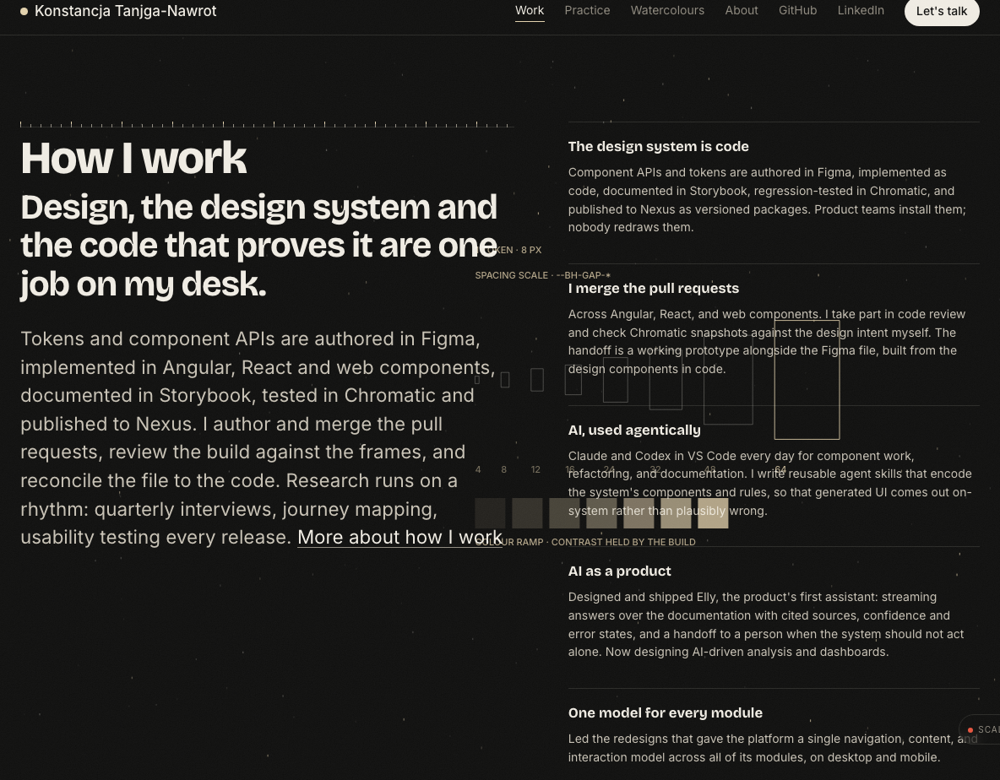 | 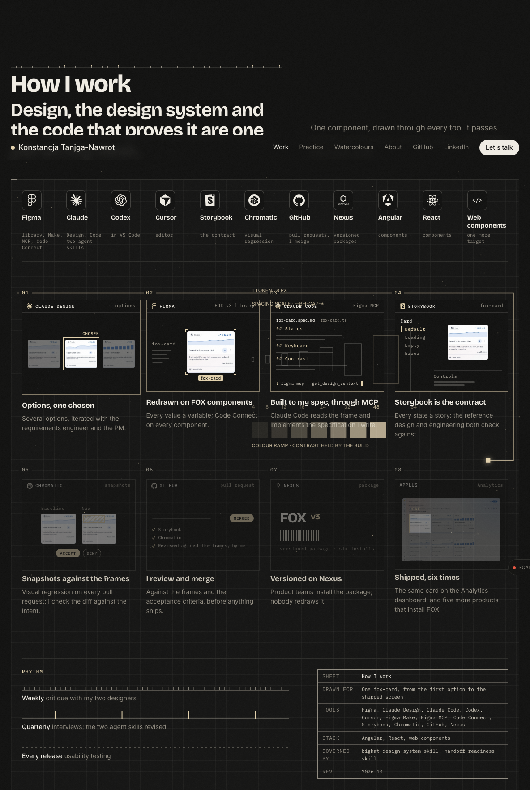 |
| 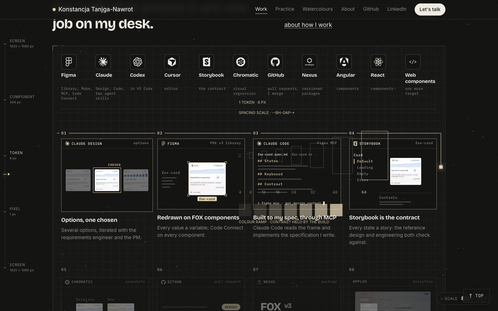 | 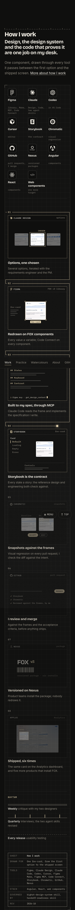 |

Open: the journey's token overlay (spacing scale, colour ramp) crosses
the windows while the sheet is in view; it is kept as it is.

### 19 October: Prague in mockups

Konstancja asked for the Prague watercolours to sit in mockups like New York, Birds and Animals. The rooms are generated (Figma AI, empty interiors only, no frame and no art); her scans are composited into them, so the painting itself is never redrawn by a model. Each scan gets a frame and a passe-partout in its own proportions (DOX black, Emmaus pale oak, food walnut, with wood grain), a contact and cast shadow, and the wall's own light (the leaf shadows by the window) carried onto the frame. The script is [prague-mockups-compose.py](prague-mockups-compose.py); the old flat scans are in git history.

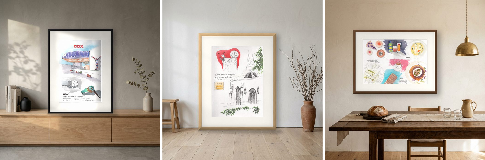

### 20 October: France, Loire and castles in mockups

The same method as Prague, nine rooms this time, chosen from the kinds of scene in Konstancja's own Photoshop mockup library (over a sofa, on a mid-century sideboard, leaning against a sofa, above a bed, on a green wall, on a desk, on an empty wall with window shadows) and matched to each painting: Cèdre Noir leans against a green sofa, Chambord hangs above a marble fireplace in a panelled salon, Chenonceau above a bed, Chaumont on a teak sideboard, Saumur on a sage wall, Clos Lucé on a scholar's desk, the Nantes elephant in a concrete loft, Le Vazereau in a farmhouse kitchen, and the Chinon wines on a tuffeau wall above a tasting table. Rooms generated empty; the scans composited in. Frames vary with the room (walnut, gilt, white, oak, black, steel). Where a frame stands in front of furniture, the wall's light is not carried onto it, or the sofa's pattern would show through the painting.

The home page keeps its three flat plates (Chenonceau, Chambord, Le Cèdre Noir) by choice, so those thumbnails stay in `public/`; `check-content` now also checks `src/home`, which is how a deleted plate would have been caught.

Scripts: [mockuplib.py](mockuplib.py) and [france-mockups-compose.py](france-mockups-compose.py).

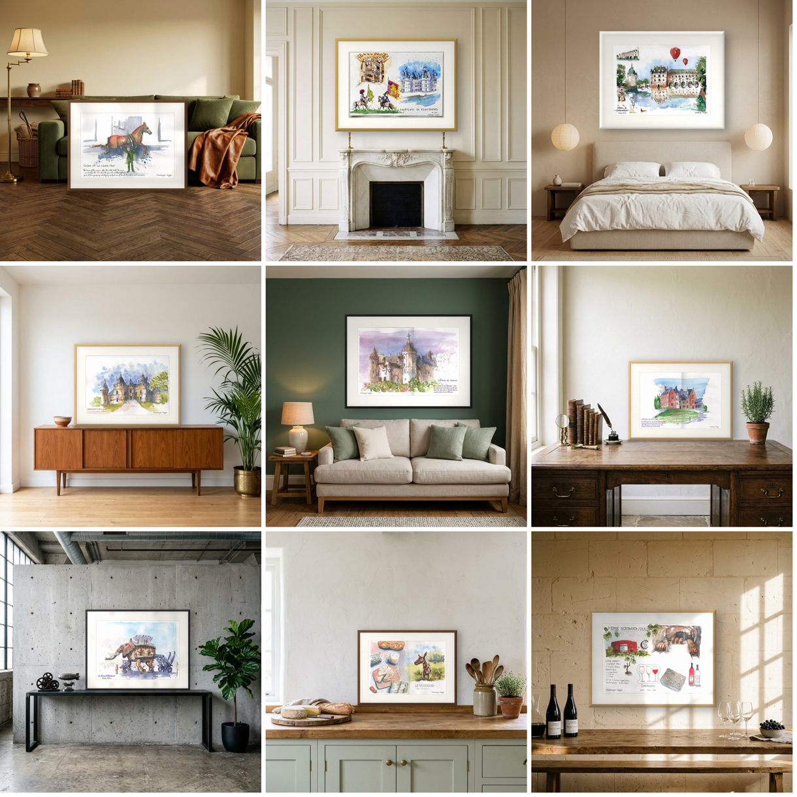

### 20 October: the painting first, Málaga and Portugal

Konstancja's note on the first two series: the watercolours were too small, even in the lightbox; the room is background and must not dominate. Every mockup is now cropped tight around its frame, so the frame fills about 76 % of the width of a 5:4 crop (78 % of the height of a 4:5 crop for upright paintings), and it is composed at twice the room's size so the scan keeps its full sharpness while the room goes slightly soft, like a shallow depth of field. The light carried from the wall is capped low, so the colours of the paintings stay true. Prague and France were re-rendered this way from their scans in git history, and Málaga (six rooms: a bright living room, an Andalusian hallway, an olive tree on terracotta, a seaside bench, an architect's office, a white bench with geraniums) and Portugal (a Lisbon café, a stone wall above a bench, a sideboard with blue-and-white ceramics, a navy velvet sofa, an azulejo hall, a fado room) were made the same way.

One script now does all four series: [mockups2.py](mockups2.py) with [mockuplib.py](mockuplib.py); Portugal's jobs are in [mockups2-portugal-jobs.json](mockups2-portugal-jobs.json).

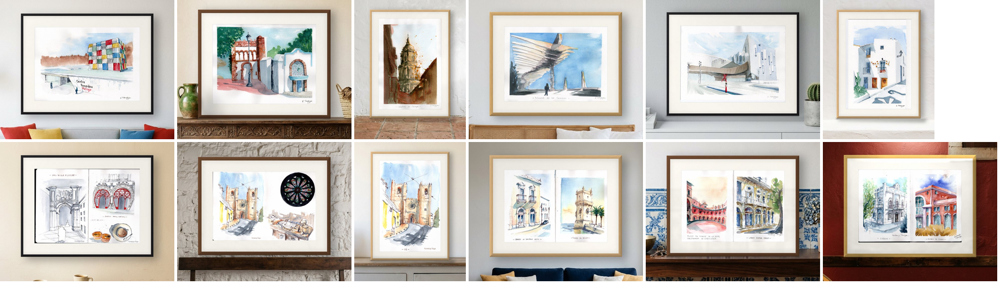
